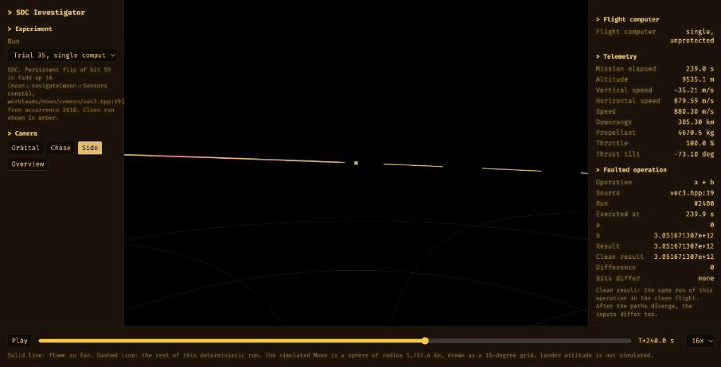
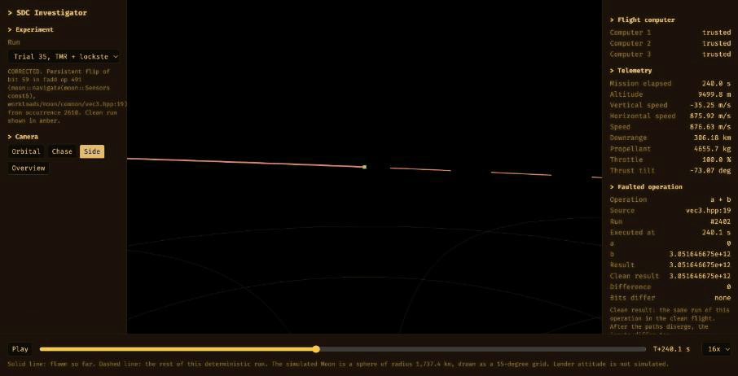

One stuck bit in a lander's flight computer can crash it into the Moon.

{ width="1000" }

*Blue is the clean landing, orange is the same landing with one stuck bit. The faulted lander hits the surface at 113 m/s, 16 km from where it should be, and the software never notices.*

This past week I've been building a tool to find out how that happens and what stops it.

## The problem

The failure in question is called silent data corruption (SDC), which happens when things like cosmic rays or solar particles cause bit flips in flight computers. The program might not immediately crash when this happens, but if left unchecked, it can compute a wrong answer.

Near the Moon there's no atmosphere or magnetic field to prevent this like we have on Earth, so bit flips happen far more often up there.

Now, I obviously can't produce cosmic radiation (not that I would lol), so I decided to simulate this with software.

## Fly me to the moon

This is "Fly me to the moon", and here's what it can do:

- LLVM compiler pass to rewrite double-precision arithmetic operations in the C++ flight software (to inject bit flips).
- Bit-exact traces so we can compare a clean run against a faulted one (indicate where a fault started and whether it changed the outcome of the mission)
- Runs hundreds of random faults at once, and every result can be replayed exactly.
- The landing is scored on the real physics against the Apollo Lunar Module's landing limits

To pull this off, I had to learn what the compiler actually does to the math first though because certain optimizations prevented me from injecting my own SDC faults.

Of these, I had to turn off:

- FMA contraction (a compiler optimization that fuses floating point multiply and addition operations into one).
- Vectorization because it moved arithmetic below the intermediate representation (IR)

## Why a landing

For the demo above, I picked a lunar landing. I'd expect a bit flip during the coast to the Moon to matter less, since there's usually time to recover, but descent is different. During descent the engine follows every guidance calculation, and a fault that keeps repeating has no time to be fixed.

So now I can inject faults, YAYYYY

## Borrowing from SpaceX

But how do I defend against them? I looked at how SpaceX protects Dragon.

Instead of using extremely expensive radiation-hardened chips, Dragon runs three flight computers, each one with a pair of processors checking each other, similar to lockstep. If any pair disagrees, that computer drops out and the other two keep flying. That actually happened, for context, on a [2012 cargo mission](https://www.americaspace.com/2012/12/02/in-spite-of-octobers-mishap-spacexs-computers-are-a-go/), when one computer lost sync after a suspected radiation hit.

I built the same sort of layout: 3 computers, 2 cores each, with each core as its own compiled copy of the flight software.

I wasn't able to find a good primary source as to whether they do voting with the valid processor pairs, but this is what I've decided to do.

{ width="1000" }

*The exact same stuck bit, now with the redundant computers. Computer 2's cores disagree, it goes silent, and the other two land at 1 m/s right on target.*

## Results so far

200 faults each:

| Fault | Defense | Result |
|---|---|---|
| One-time bit flip | none | the control loop corrects all 200 on the next tick |
| Stuck bit (like a defective core) | none | 28 of 200 landings fail |
| Stuck bit, confined to one core | SpaceX-style layout | 0 of 200 fail |

In those 28 failed runs, the wrong value spread through navigation and guidance into the engine commands, and the lander touched down too fast or too far off target. The software never crashed and nothing reported an error.

## What's next

Next I'm testing the case that last result leaves out, where the same fault hits several computers at once.

Once that's done, I'm putting the instrumented flight software in the browser so anyone can inject faults into a landing and watch it play out.

Running everything six times is expensive though, so I'm thinking maybe there's a way to have a sort of arbiter that uses the traces from these fault runs to decide which parts of the code actually need protecting.

This is just the beginning of this project, so stay tuned for updates :)

Code: <https://github.com/fr4nsyz/fly-me-to-the-moon>
